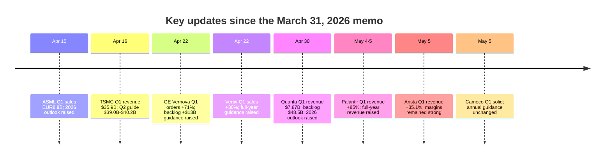
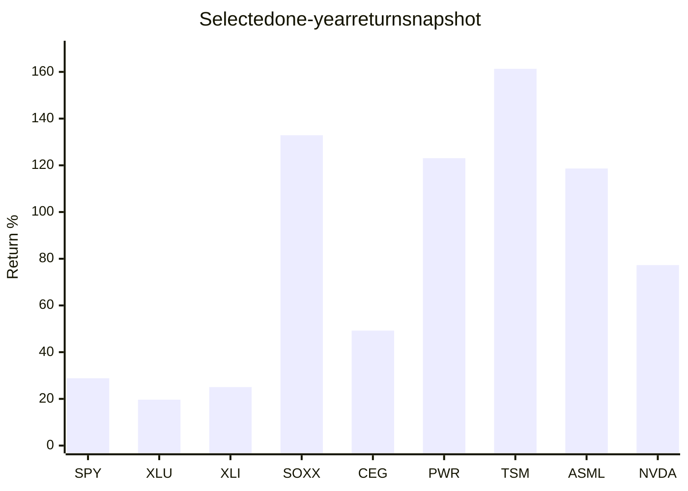
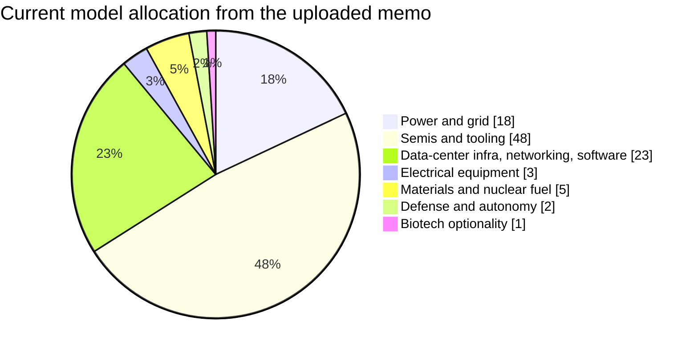

# Validity Review of the Event Horizon Fund Portfolio

**Generated from the completed Deep Research report**  
**Date of review:** May 6, 2026  
**Source memo reviewed:** Event Horizon Fund Deep Dive Analysis, dated March 31, 2026

---

## Executive Summary

The March 31, 2026 Event Horizon Fund memo remains broadly valid **at the thesis level**, but it is no longer fully valid **at the security-weight level**. The core logic in the uploaded memo - that AI infrastructure should keep driving demand for power, grid equipment, semicapex, networking, memory, and selected nuclear assets - has held up. Recent operating updates from Taiwan Semiconductor Manufacturing Company, ASML, Quanta Services, GE Vernova, Vertiv, Arista Networks, and Cameco all point in the same direction: demand is still strong and, in several cases, guidance has moved higher.

What has changed is valuation, crowding, and correlation risk. Several winners in the portfolio now trade at much richer valuation levels than they did when the quarter-end memo was prepared, especially PWR, GEV, VRT, and PLTR. In multiple cases, public consensus price targets now sit below or only slightly above market prices, even while operating trends remain healthy. That is usually a signal to **keep the thesis but rebalance the expression of the thesis**.

My bottom line is: **do not rewrite the portfolio; do rebalance it**. Keep the AI-infrastructure and power thesis, but trim the most overextended names, reduce single-name concentration, and add some ETF ballast in semis, utilities, defense, and biotech so the portfolio is less dependent on a single macro variable: hyperscaler AI capex.

## Scope, assumptions, and what is missing

The uploaded memo provides a target portfolio with 22 positions and explicit weights that sum to 100%, led by CEG and TSM at 12% each, followed by ASML and VRT at 8% each, then a cluster of 4% to 6% positions across semis, infrastructure, and software. I treat that model portfolio as the working portfolio for this review because no live brokerage statement, tax lots, account type, or actual drifted weights were provided.

Because your time horizon, risk tolerance, investment objective, tax status, and liquidity needs were explicitly left open-ended, I am making a base-case assumption of a **long-term growth investor** with a **high tolerance for volatility**, **low near-term liquidity needs**, and no active tax-loss or cash-flow constraints. If that assumption is wrong - especially if the account is taxable with embedded gains, or if your true objective is drawdown control rather than maximum upside capture - the ETF-heavy rebalancing scenario later in this report is the better fit. Those assumption gaps are material because they change whether the right answer is "trim aggressively," "hold through volatility," or "de-risk mainly through new money."

## What still works and what has changed

The strongest evidence in favor of the original thesis is that the portfolio's key demand chain is still being confirmed by company results. TSMC reported Q1 2026 revenue of $35.9 billion, gross margin of 66.2%, and guided Q2 revenue to $39.0 billion to $40.2 billion. ASML reported Q1 2026 sales of EUR8.8 billion and raised its 2026 revenue outlook to EUR36 billion to EUR40 billion, explicitly citing ongoing AI-related infrastructure demand. Quanta reported record Q1 revenue, EPS, free cash flow, and a record $48.5 billion backlog while raising 2026 expectations. GE Vernova reported 71% order growth, backlog growth of more than $13 billion sequentially, and raised 2026 guidance. Vertiv reported 30% sales growth and higher full-year guidance, driven by data-center demand. Arista reported 35.1% revenue growth with operating margins still near 48%. Cameco's Q1 was consistent with annual guidance and reinforced the long-term nuclear demand backdrop.

At the same time, the portfolio has become **economically less diversified than it looks**. Even though the memo holds 22 names, roughly **48%** of the capital sits in semis, foundry, tools, EDA, and accelerators, and another **23%** sits in data-center infrastructure, networking, cybersecurity, and operations software. That means about **71%** of the model portfolio is tied to one dominant macro driver: continued AI and data-center spending. Add the power sleeve and the concentration to the same end-market gets even stronger. The top five positions alone account for **46%** of capital, and the top ten account for **71%**.

That concentration would be easier to defend if valuations were still moderate. They are not. PWR trades around 87x trailing earnings and about 45x forward earnings. GEV trades around 56x trailing earnings and about 69x forward earnings. VRT trades around 88x trailing and about 48x forward earnings, with EV/EBITDA above 54x. PLTR just posted a very strong quarter, but the stock is still being challenged by valuation despite raised guidance. Even ASML and AMAT, while still strategically important, are much closer to fair value after their runs.

The benchmark backdrop is also mixed in a way that matters. Utilities and industrials have held up well, semiconductors have massively outperformed, aerospace and defense has been positive but less explosive, and biotech has been far more muted. That supports the thesis of keeping exposure, but it also argues for **broadening the expression** of that exposure, not doubling down on the same high-beta names. Because public benchmark snapshots come from different providers and a slightly different set of dates, the table below should be used directionally rather than as an audit-grade performance record.

| Benchmark | 3M | 6M | YTD | 1Y | What it says |
|---|---:|---:|---:|---:|---|
| SPY | -0.83% | n/a | +0.93% | +28.84% | Broad market recovered, but not close to semiconductor leadership. |
| XLU | +5.96% | +11.39% | +8.23% | +19.64% | Utilities stayed constructive and lower-beta. |
| XLI | +3.54% | +12.87% | +4.59% | +25.05% | Industrials benefitted from grid and capex themes. |
| XLK | +9.59% | +33.92% | -7.52% | +29.51% | Tech recovered sharply after a weak start to the year. |
| SOXX | +20.97% | +44.10% | +27.99% | +132.89% | Semiconductors remain the strongest sleeve by far. |
| ITA | +1.94% | +4.52% | +1.94% | +43.53% | Defense is positive, but less crowded than AI infrastructure. |
| IBB | +0.12% | +17.18% | +0.12% | +32.35% | Biotech improved, but still behaves differently from AI cyclicals. |

The same pattern shows up in selected holdings. Again, because these public snapshots are not all pinned to the exact same day, use them to understand **rank order and dispersion**, not to reconcile to a brokerage statement.

## Position review and recommendations

The current model allocation implied by the uploaded memo is visually diversified, but at the factor level it is very concentrated in semis and AI-adjacent infrastructure. This pie chart uses a high-level sleeve mapping from the memo's ticker weights.

### Core and support infrastructure positions

| Ticker | Current wt. | Proposed wt. | Recommendation | Time horizon | Confidence | Key reason |
|---|---:|---:|---|---|---|---|
| CEG | 12% | 10% | Hold, modest trim | 2-5 years | High | Thesis intact after Calpine integration and nuclear/data-center positioning, but 12% is too concentrated for a single utility-like name. |
| VST | 3% | 4% | Buy on weakness | 1-3 years | Medium | Attractive way to keep power exposure; Meta's long-duration nuclear agreements help the story, and valuation is still less stretched than some peers. |
| PWR | 3% | 2% | Trim | 1-2 years | Medium | Operating momentum is exceptional, but the stock has outrun fundamentals after the Q1 beat-and-raise and record backlog. |
| GEV | 3% | 2% | Trim | 1-2 years | Medium | Orders and backlog remain excellent, but forward valuation is now unusually demanding and consensus upside is limited. |
| VRT | 8% | 6% | Trim | 1-2 years | Medium | Q1 and guidance were excellent, but 8% is too large for a name trading near 87x trailing earnings and about 20% above average target. |
| DELL | 5% | 4% | Hold | 1-3 years | Medium | AI server growth and cash flow look strong, and valuation is reasonable versus the group, but leverage and limited target upside argue for a slightly smaller weight. |
| ANET | 5% | 5% | Buy/Hold | 2-5 years | High | One of the cleanest AI-infrastructure expressions: Q1 revenue grew 35.1% with very strong margins and product-cycle momentum. |
| CRWD | 3% | 3% | Hold | 2-5 years | Medium | Quality compounding story with ARR above $5.25 billion and strong free cash flow, but still not cheap enough to increase here. |
| PLTR | 2% | 1% | Trim | 1-3 years | Medium | Q1 was outstanding and guidance went up, but valuation is still the central issue; keep a smaller position, not a larger one. |
| AVAV | 1% | 1% | Hold, speculative | 2-5 years | Medium | Backlog and bookings remain strong, but execution timing and government budget cadence make this better as a small position. |
| KTOS | 1% | 1% | Hold, speculative | 2-5 years | Low | The defense-autonomy theme still fits, but I have less up-to-date company-specific evidence than for AVAV or ITA, so confidence is lower. |
| CCJ | 2% | 2% | Buy/Hold | 2-5 years | High | Q1 was solid, guidance stayed intact, and long-term nuclear fuel fundamentals continue to improve. |

### Semiconductor, memory, and software enablement positions

| Ticker | Current wt. | Proposed wt. | Recommendation | Time horizon | Confidence | Key reason |
|---|---:|---:|---|---|---|---|
| TSM | 12% | 10% | Hold, modest trim | 2-5 years | High | Best-in-class operating evidence: strong Q1, very strong Q2 guide, and still reasonable forward valuation for the quality. Trim only to reduce concentration. |
| ASML | 8% | 7% | Hold, modest trim | 2-5 years | High | Strategic monopoly-like exposure remains intact, but after the run the stock is much closer to fair value than it was at quarter-end. |
| AMAT | 4% | 3% | Hold | 1-3 years | Medium | Strong balance sheet and good economics, but it is harder to justify increasing ahead of the next print when valuation is already full. |
| NVDA | 6% | 6% | Hold, add only on pullbacks | 2-5 years | High | Still the central AI compute beneficiary, and forward valuation is not extreme versus its growth profile; keep as a core name. |
| AVGO | 3% | 4% | Buy modestly | 2-5 years | High | Custom silicon plus networking keeps AVGO highly relevant to the same AI buildout, with a more balanced risk/reward than several other winners. |
| MU | 6% | 6% | Buy/Hold | 1-3 years | High | Micron's Q2 was record-level, cash generation was very strong, and Q3 guidance stayed aggressive. This remains one of the cleaner cyclical beneficiaries. |
| SNPS | 5% | 4% | Hold | 2-5 years | Medium | Essential "tollbooth" exposure to semiconductor design, but valuation is already rich enough that a slightly smaller weight is prudent. |
| INTC | 4% | 3% | Speculative hold | 2-5 years | Low-Medium | Strategic domestic foundry optionality remains real, but execution risk is still high; keep exposure, just smaller. |
| MP | 3% | 2% | Hold/trim | 2-5 years | Low-Medium | Strategic rare-earth exposure still fits the thesis, but operating execution is less proven than the core AI/power names. |
| MRNA | 1% | 0% | Sell/replace | 1-3 years | Medium | This looks least connected to the portfolio's dominant thesis and adds idiosyncratic biotech risk without enough portfolio-level payoff. |

The main pattern is simple. **Keep the platform winners; trim the valuation winners.** The names that still deserve to sit at the center of the portfolio are TSM, ASML, NVDA, MU, ANET, CEG, and selected power exposure. The names that now look better as smaller positions are PWR, GEV, VRT, and PLTR. DELL, AVGO, VST, SNPS, and CRWD sit in the middle: worth owning, but not worth chasing aggressively at these levels. The satellite names are fine as optionality, but MRNA is the clearest mismatch with the main portfolio objective unless you intentionally want that non-correlated biotech exposure.

## Rebalancing scenarios and alternatives

### Recommended base-case rebalance

My preferred rebalance is **evolutionary, not revolutionary**. It keeps the same high-conviction macro view, lowers top-name concentration, and adds diversified sleeves where the portfolio is currently weakest. The proposed target weights below sum to 100%.

| Position / sleeve | Proposed weight |
|---|---:|
| CEG | 10% |
| VST | 4% |
| PWR | 2% |
| TSM | 10% |
| ASML | 7% |
| AMAT | 3% |
| VRT | 6% |
| DELL | 4% |
| NVDA | 6% |
| AVGO | 4% |
| MU | 6% |
| SNPS | 4% |
| ANET | 5% |
| CRWD | 3% |
| PLTR | 1% |
| AVAV | 1% |
| KTOS | 1% |
| MP | 2% |
| INTC | 3% |
| GEV | 2% |
| CCJ | 2% |
| SOXX | 6% |
| XLU | 4% |
| ITA | 2% |
| IBB | 2% |

This rebalance lowers the top-five concentration from **46% to 39%**, spreads some single-name risk into ETFs, and still leaves the portfolio decisively tilted toward AI infrastructure, power, and selected defense autonomy. It also removes the weakest objective fit, MRNA, without walking away from upside exposure.

### Alternative scenarios

If your true objective is **maximum upside with high volatility tolerance**, keep the portfolio more concentrated and only trim the most extended names: cut PWR, GEV, VRT, and PLTR; eliminate MRNA; leave most other weights unchanged; add only a small SOXX sleeve. That preserves the memo's original spirit and still acknowledges valuation drift.

If your true objective is **risk-adjusted compounding**, use a more ETF-heavy mix: cut CEG, TSM, ASML, and VRT more aggressively; replace that weight with SOXX, XLU, ITA, and IBB; and keep only your highest-conviction single names as overweights. That version should reduce drawdown sensitivity to any single earnings cycle or any one AI-capex slowdown.

### Best alternatives to add

| Add / substitute | Why it helps | Main trade-off | Best use case |
|---|---|---|---|
| SOXX | Instantly diversifies the semiconductor sleeve that is currently spread across many correlated single names; recent performance has been extremely strong. | Still cyclical and growth-heavy. | Best replacement for part of TSM/ASML/AMAT/NVDA concentration. |
| XLU | Adds lower-beta utility exposure with positive YTD and 1Y returns, while reducing single-name power risk. | Less upside torque than CEG or VST. | Best for investors prioritizing drawdown control in the power sleeve. |
| ITA | Gives defense exposure without relying on one or two autonomy names. | Broader aerospace mix dilutes pure-drone upside. | Best substitute for concentration in AVAV/KTOS. |
| IBB | Keeps a health-care diversifier without making a single-company biotech bet. | Less explosive than a successful single biotech. | Best replacement for MRNA. |
| ETN | A strong single-stock alternative for electrification and data-center power equipment, with lower realized volatility than many pure AI-infrastructure winners. | Less upside torque than the hottest momentum names. | Best substitute if you trim PWR/GEV but still want a power-equipment compounder. |

## Open questions and limitations

There are four material limitations to this review. First, I evaluated the **model portfolio in the uploaded memo**, not an actual live account with drift, tax lots, and realized gains or losses. Second, your constraints are intentionally open-ended, so portfolio advice that is right for a long-horizon, pre-tax growth investor may be wrong for a short-horizon or taxable-income investor. Third, a few important holdings are close to or between earnings prints, so near-term sizing should remain flexible. In particular, VST's report was due on May 7, CEG's Q1 call is scheduled for May 11, AMAT's next estimated print is May 14, and DELL's next estimated print is May 28.

Fourth, the public return snapshots available without a synchronized institutional market-data feed are not perfectly date-matched across all holdings and benchmarks. I therefore used them primarily to assess **direction, relative strength, and dispersion**, not to produce an audit-grade performance workbook. If you want the next pass to be fully normalized at the security level - exact 3-, 6-, 12-month and YTD total returns, rolling volatility, beta, maximum drawdown, factor loadings, and a correlation matrix - the missing ingredient is not research judgment; it is your actual holdings file plus a single clean price-history source used consistently across every name.

---

## Source links referenced by the Deep Research report

The original Deep Research output used source references that do not export cleanly outside the research widget. I preserved the core report text above and list the major referenced source URLs here for convenience.

- https://investor.tsmc.com/english/encrypt/files/encrypt_file/qr/phase4_reports/2026-04/bd8eb0403902fdea59a2f5e390e48d010b50edc9/1Q26%20EarningsRelease_WoG.pdf
- https://www.asml.com/en/news/press-releases/2026/q1-2026-financial-results
- https://investors.quantaservices.com/news-events/press-releases/detail/396/quanta-services-reports-first-quarter-2026-results
- https://www.gevernova.com/news/press-releases/ge-vernova-reports-first-quarter-2026-financial
- https://www.prnewswire.com/news-releases/vertiv-reports-strong-first-quarter-with-diluted-eps-growth-of-136-adjusted-diluted-eps-growth-of-83-raises-full-year-guidance-302750110.html
- https://www.arista.com/company/news/press-release/24017-pr-20260505
- https://www.cameco.com/media/news/cameco-reports-2026-first-quarter-results
- https://www.reuters.com/business/palantir-tops-first-quarter-revenue-estimates-strong-us-government-demand-2026-05-04/
- https://www.constellationenergy.com/content/constellationenergy/en/news/2026/02/constellation-reports-fourth-quarter-and-full-year-2025-results
- https://www.reuters.com/business/energy/meta-strikes-nuclear-power-agreements-with-three-companies-2026-01-09/
- https://www.dell.com/en-us/dt/corporate/newsroom/announcements/detailpage.press-releases~usa~2026~2~dell-technologies-delivers-fourth-quarter-and-full-year-fiscal-2026-results.htm
- https://ir.crowdstrike.com/news-releases/news-release-details/crowdstrike-reports-fourth-quarter-and-fiscal-year-2026/
- https://investor.avinc.com/news-releases/news-release-details/aerovironment-announces-fiscal-2026-third-quarter-results
- https://newsroom.intel.com/corporate/intel-reports-first-quarter-2026-financial-results
- https://www.nasdaq.com/press-release/mp-materials-reports-fourth-quarter-and-full-year-2025-results-2026-02-26
- https://www.ishares.com/us/products/239502/ishares-us-aerospace-defense-etf
- https://www.ishares.com/us/products/239699/IBB
- https://www.ssga.com/us/en/intermediary/etfs/state-street-utilities-select-sector-spdr-etf-xlu
